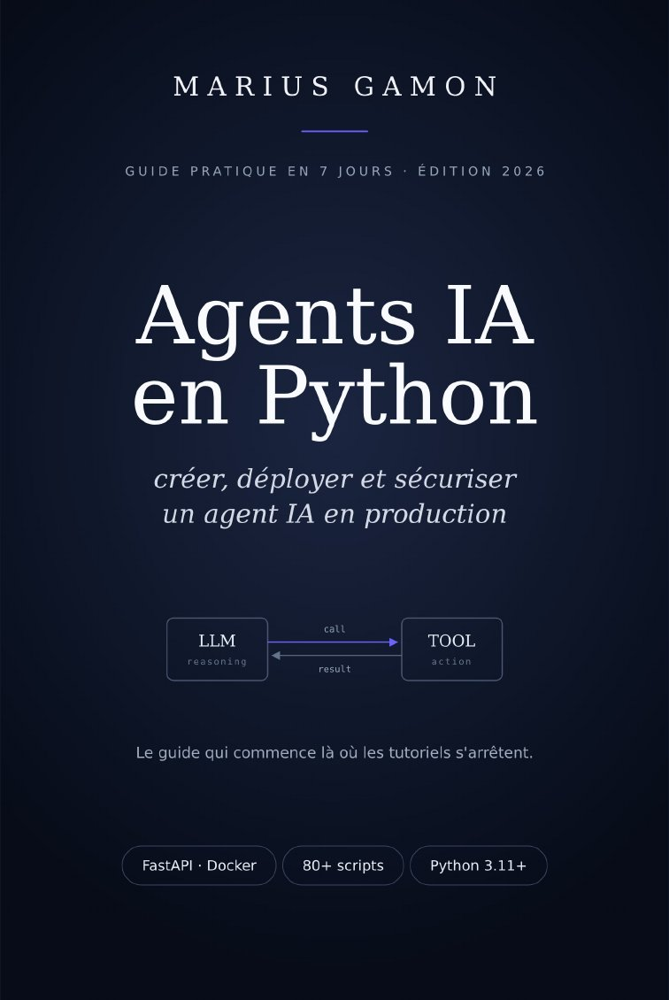

# Agents IA en Python — code du livre

<p align="center">
  
</p>

Code source compagnon du livre **« Agents IA en Python : créer, déployer et sécuriser un agent IA en production »** (Marius Gamon, 2026).

Le livre est disponible en PDF et EPUB sur [Gumroad](https://mariusgamon.gumroad.com/l/agents-ia-python), et sur Amazon en version Kindle et brochée. L'avant-propos et le Jour 1 sont [gratuits](https://mariusgamon.gumroad.com/l/extrait-agents-ia-python). Ce dépôt contient son code, prêt à lancer et testé.

Chaque fichier reprend le code du chapitre correspondant. Les rares écarts avec le livre (corrections trouvées en testant) sont listés dans [`ERRATA.md`](ERRATA.md).

> Testé le 28 octobre 2026 avec Python 3.12, `openai-agents==0.24.0` et `openai==3.40.0`.

## Installation

```bash
git clone https://github.com/mariusgamon/agents-ia-python-book.git
cd agents-ia-python-book

python3 -m venv .venv
source .venv/bin/activate          # Windows : .venv\Scripts\activate
pip install -r requirements.txt
# pip install -r requirements-optional.txt   # annexes multi-provider, deepeval, syrupy

cp .env.example .env               # puis renseignez au minimum OPENAI_API_KEY
```

Vérification : `python -c "from agents import Agent; print('OK')"`

## Lancer un script

Comme dans le livre, chaque dossier a son propre `config.py` (chargement du `.env` et validation de la clé). **Lancez les scripts depuis leur dossier** :

```bash
cd day1
python first_agent.py
```

Le `.env` à la racine du repo est trouvé automatiquement depuis n'importe quel sous-dossier.

## Contenu

| Dossier | Chapitre |
|---|---|
| `intro_examples/` | Avant-propos — l'agent de veille tech, version simplifiée |
| `day1/` | Premier agent, lecture de fichier (`data/notes.txt`), garde-fous de coût, retry |
| `day2/` | Tool calling : TVA, météo, recherche web, code interpreter, les 4 crashs classiques |
| `day3/` | Mémoire : `SQLiteSession`, `memory_store.py`, mémoire sémantique, coûts, lookup ciblé |
| `day4/` | Multi-agents : handoffs, LangGraph (séquentiel, conditionnel, parallèle) |
| `day5/` | Robustesse : retry sûr, observabilité (Langfuse, Logfire), tests (`tests/`) |
| `day6/` | Déploiement : API FastAPI, Docker, docker-compose, Fly.io, middlewares |
| `day7/` | Cas pratiques : veille tech, rapport de sprint, orchestrateur dev, monitoring |
| `bonus_from_scratch/` | Annexe B — agent sans framework (API Mistral en HTTP brut) |
| `annexes/` | Annexes C et E — multi-provider (Claude, OpenRouter, LangGraph), patch vLLM, sécurité |
| `appendix/sandbox/` | Annexe D — Hello Sandbox |
| `templates/` | Annexe — templates Recherche / Génération / Orchestrateur |

## Clés API

| Variable | Utilisée par |
|---|---|
| `OPENAI_API_KEY` | presque tout (obligatoire) |
| `OPENWEATHER_API_KEY` | `day2/weather_agent.py`, `day5/tools/weather.py` (clé gratuite sur openweathermap.org) |
| `API_SECRET_KEY` | `day6/` (API FastAPI) |
| `SLACK_WEBHOOK_URL` | `day7/tech_watch.py`, `intro_examples/tech_watch.py` (sinon le rapport s'affiche sans être envoyé) |
| `GITHUB_TOKEN` | `day7/sprint_report.py` |
| `MISTRAL_API_KEY` | `bonus_from_scratch/` |
| `ANTHROPIC_API_KEY`, `OPENROUTER_API_KEY` | `annexes/` (multi-provider) |
| `LANGFUSE_*`, `LOGFIRE_TOKEN` | `day5/observe_with_*.py` |

**Non testé avec un vrai compte** (faute de clé au moment des tests) : `annexes/first_agent_openrouter.py` (OpenRouter) et l'envoi réel des traces de `day5/observe_with_logfire.py` vers Logfire (le script a été vérifié avec `LOGFIRE_SEND_TO_LOGFIRE=false`).

Par défaut, l'OpenAI Agents SDK envoie les traces d'exécution à OpenAI. Ajoutez `OPENAI_AGENTS_DISABLE_TRACING=1` dans le `.env` pour les couper (voir §5.5).

## Jour 5 — tests

```bash
cd day5
pytest tests/test_tools.py tests/test_pipeline.py tests/test_agent_with_respx.py   # sans appel LLM, gratuit
pytest tests/                                                                     # tout (appelle l'API : quelques centimes)
```

`tools/`, `my_pipeline.py` et `my_agents.py` sont le code « de production » que les tests du livre importent.

## Jour 6 — API FastAPI

```bash
cd day6
cp .env.example .env               # OPENAI_API_KEY + API_SECRET_KEY
uvicorn app.main:app --reload --port 8000
# ou : docker compose up --build
```

Puis `http://localhost:8000/docs`, ou :

```bash
curl -X POST http://localhost:8000/api/chat \
  -H "Content-Type: application/json" -H "X-API-Key: <API_SECRET_KEY>" \
  -d '{"message": "Bonjour"}'
```

`day5/ci/` et `day6/ci/` contiennent les workflows GitHub Actions du livre, à copier dans `.github/workflows/` de votre propre projet.

## Fichiers à ne pas lancer seuls

- **Bibliothèques**, importées par d'autres scripts : `day3/memory_store.py`, `day3/smart_memory_lookup.py`, `day2/tool_*.py`, `day4/email_pipeline_*.py`, `day6/app/…`, `annexes/vllm_compat.py`, etc.
- **Fragments du livre**, qui se terminent par un `await` au niveau du module et utilisent des symboles définis dans le texte : `day2/orchestrator_naive.py`, `day2/orchestrator_relay.py`, `annexes/document_sanitizer.py`. Intégrez-les dans votre propre `async def main()`.
- **Noms de modèles** : le code utilise ceux du livre (`gpt-5.4-mini`, `gpt-5.4`, `claude-sonnet-4-6`…). Adaptez-les si votre compte n'y a pas accès.

## Licence

Le code de ce dépôt est sous licence MIT (voir [`LICENSE`](LICENSE)). Le texte du livre, ses figures et sa couverture ne sont pas couverts par cette licence : ils restent © Marius Gamon, 2026, tous droits réservés.
